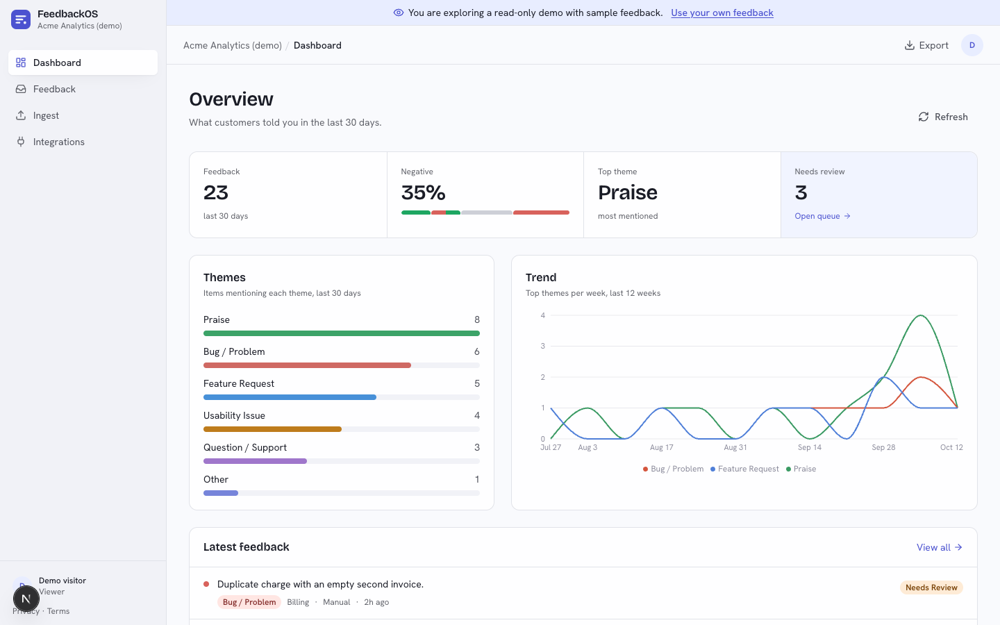
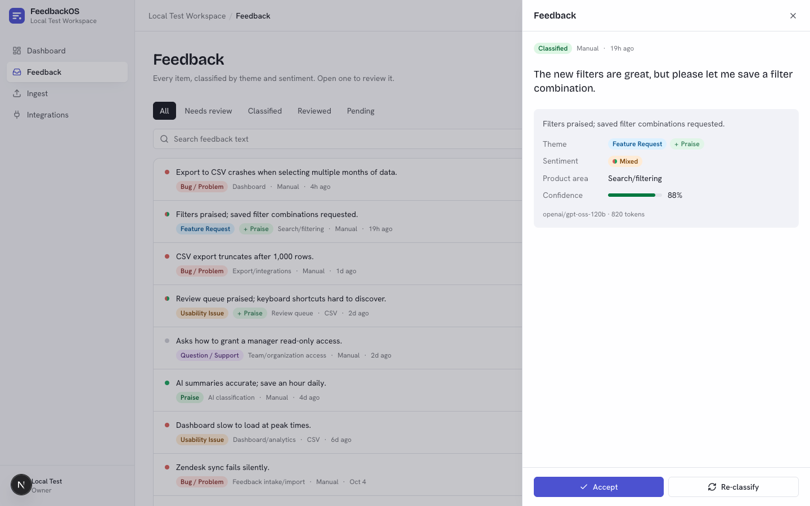
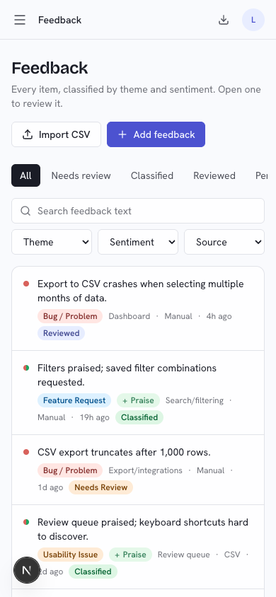
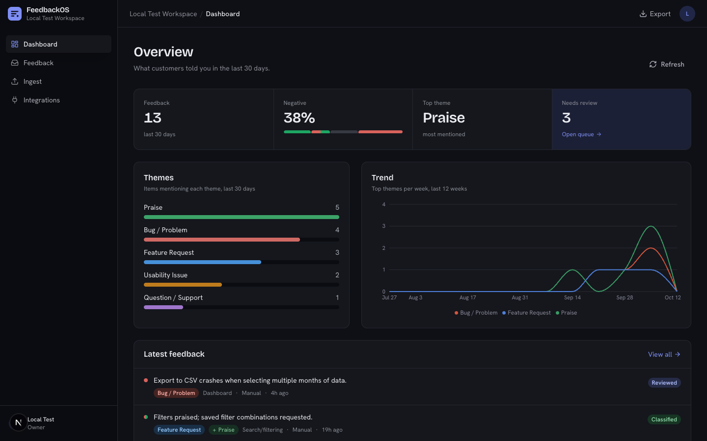
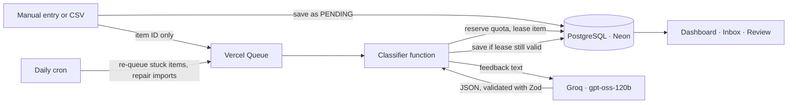

# FeedbackOS

**AI triage for customer feedback.** Paste a message or import a CSV, and FeedbackOS tags every item by theme, sentiment and product area, keeps the praise that hides inside complaints, and sends uncertain results to a human review queue.

**[Try the live demo →](https://feedbackos.vercel.app/api/demo)** (read-only, no sign-up) · [Sign in](https://feedbackos.vercel.app/login) to use your own feedback.



## What it does

- **Classifies every item** into one of six themes (bug, feature request, usability issue, question, praise, other), a sentiment (positive, negative, neutral, mixed) and a product area, with a confidence score and a one-line summary.
- **Keeps mixed feedback intact.** "The UI is great, but checkout needs work" becomes *Feature request + Praise · Mixed*, so praise is counted instead of lost.
- **Routes doubt to people.** Low-confidence or sensitive items land in a *Needs review* queue, where a reviewer can accept or re-classify them.
- **Imports CSVs safely.** Files of up to 2,000 rows go straight from the browser to private storage, are validated before anything is written, and are classified in the background while the page shows live progress.
- **Shows the trend.** A dashboard with theme counts, sentiment split, a 12-week trend and a direct link to the review queue.
- **Works everywhere.** Light and dark mode, a phone layout, keyboard navigation, and screens that pass automated accessibility checks.

| Feedback detail | Phone | Dark mode |
| --- | --- | --- |
|  |  |  |

## How it works



- **The database is the source of truth.** Feedback is saved before any AI call; the queue only carries IDs. A lost message or a crashed function never loses feedback: a watchdog retries after the lease expires, and a daily cron re-queues anything left behind.
- **Leases prevent stale writes.** Each classification holds a two-minute lease, so a slow or duplicate run can never overwrite a newer result or a human review.
- **One shared AI budget.** Every call reserves tokens and requests against Groq's free-tier limits and refunds what it did not use. Bulk CSV rows are spaced out so manual feedback stays fast.
- **Serverless end to end.** No always-on worker: Vercel Functions, Queues, Blob and Cron do the work.

More detail: [architecture](docs/architecture.md) · [operations and deployment](docs/operations.md).

## Tech stack

Next.js 16 (App Router) · React 19 · TypeScript · Tailwind CSS 4 · Prisma 5 + PostgreSQL (Neon) · Redis (Upstash) · Auth.js v5 (Google + email magic link) · Vercel Queues, Blob and Cron · Groq (OpenAI-compatible SDK) · Zod · Recharts · Jest · Playwright.

## Security and fair use

- Every API route checks the session and the workspace; view-only members cannot change anything.
- Every route is rate-limited (per account for signed-in routes, per IP for public ones); sign-in emails are capped per address and per IP.
- Each workspace may add 500 new items per day (configurable) and each person may own one workspace, so nobody can drain the shared AI quota.
- Webhooks and the cron job reject unsigned requests; CSV files are private and deleted after import; integration credentials are encrypted (AES-256).
- Security headers (no framing, `nosniff`, HSTS, referrer and permissions policies); exported CSV cells cannot run as spreadsheet formulas.

See the [Privacy Policy](https://feedbackos.vercel.app/privacy) and [Terms](https://feedbackos.vercel.app/terms).

## Run it locally

Requirements: Node.js 20.9+, pnpm 10, PostgreSQL 14+, Redis 6+ and a [Groq](https://console.groq.com) API key.

```bash
pnpm install --frozen-lockfile
cp .env.example .env          # fill in database, Redis, Groq and auth values
pnpm db:migrate               # create the schema in a local database
pnpm dev:next                 # http://localhost:3000
```

Every variable is described in [`.env.example`](.env.example). If Next.js picks the wrong workspace root (more than one lockfile above the project), run `npx next dev --webpack` instead.

**Signed-in testing without email.** With `LOCAL_TEST_MODE=1` on a local dev server, open `http://localhost:3000/api/test/login?next=/feedback` to sign in as a seeded test owner, and classification runs in-process instead of through Vercel Queues. It cannot be enabled on any deployment: it needs the flag, `next dev`, no Vercel environment and a localhost request.

## Tests and evaluation

```bash
pnpm test                     # unit tests; integration tests need a disposable database:
TEST_DATABASE_URL=postgresql://localhost/feedbackos_test DATABASE_URL=$TEST_DATABASE_URL pnpm test
npx tsc --noEmit && pnpm lint && pnpm build
```

The classifier is measured against a synthetic, labelled benchmark in [`evaluation/`](evaluation/README.md) (192 items with a locked test split, plus a mixed-feedback regression set). On the dev split, the current prompt scores a theme macro-F1 of 0.98 and 96% sentiment accuracy. These are synthetic examples, so they show regressions, not real-world accuracy.

```bash
node --env-file=.env --import tsx scripts/evaluate-classification.ts --split=dev --delay-ms=9000
```

## Status

FeedbackOS is a portfolio project and runs on free tiers, so large CSV imports are classified gradually (about 14 hours for 2,000 rows). Zendesk and Intercom integrations are built but marked *coming soon*: they still depend on a background worker that is not deployed.
